<div align="center">



<a href="https://www.linkedin.com/in/salhi-ibtihel-475366272"></a>
<a href="mailto:ibtihelsalhi54@gmail.com"></a>


</div>

<br/>

## About me

```yaml
name: Ibtihel Salhi
role: Cybersecurity Engineer
degree: Engineering, Information Systems and Network Security (TEK-UP, 2026)
focus:
  - Linux and RHEL hardening
  - SOC engineering, detection and incident response
  - DevSecOps pipelines and security automation
  - Cloud security on AWS and Azure
languages: [Arabic, French, English, Spanish]
looking_for: Cybersecurity Engineer | Systems, Networks and Automation
```

<br/>

## Tech stack

<div align="center">


</div>

<br/>

**Security operations**<br/>
         

**DevSecOps**<br/>
        

**Cloud security**<br/>
       

**Systems and network**<br/>
        

**Vulnerability management**<br/>
    

**Development**<br/>
    

<br/>

## Featured project: Smartovate CyberAgent

<sub>Final-year engineering project · Smartovate LTD · Jan to Sep 2026</sub>

A security automation platform that collects findings from **GitHub, AWS and Azure**, turns them into one prioritized view and drives remediation through analyst-approved pull requests.

<div align="center">

</div>

- Integrates **Semgrep, Trivy, Gitleaks, Checkov, Prowler, AWS Config, Microsoft Defender for Cloud** and **Azure Resource Graph**
- Normalizes, correlates, deduplicates and prioritizes findings with **MITRE ATT&CK** and **CIS Benchmarks**
- **FastAPI** backend with 35 REST endpoints, **PostgreSQL**, JWT, MFA and RBAC
- Automated remediation through **GitHub pull requests** and CI/CD security gates
- Deployed with **Docker, Bicep, Azure Container Apps, Service Bus** and **Key Vault**

      

<br/>

## Projects

<table>
<tr>
<td width="50%" valign="top">
<h4>Smart DevSecOps for banking microservices</h4>
<sub>TEK-UP · 2025</sub>
<p>Secured a GitHub Actions CI/CD pipeline with SAST, SCA, container, IaC and secret scanning. Runtime threat detection with Falco and workload monitoring with Prometheus, Loki and Grafana on Kubernetes.</p>
    
</td>
<td width="50%" valign="top">
<h4>Vulnerability Operations Center (SOAR)</h4>
<sub>TEK-UP · 2025</sub>
<p>Automated security workflows with TheHive, Shuffle and DefectDojo. Asset scanning with Nuclei and OpenVAS, centralized findings and CVE prioritization with CVSS, CISA KEV and OSINT enrichment.</p>
    
</td>
</tr>
<tr>
<td width="50%" valign="top">
<h4>RHEL 9.5 audit and hardening</h4>
<sub>TEK-UP · 2025</sub>
<p>Hardened RHEL 9.5 systems against CIS Benchmarks with Ansible, configured host-based filtering with Firewalld and set up continuous security monitoring with Wazuh.</p>
   
</td>
<td width="50%" valign="top">
<h4>Firewall and network security</h4>
<sub>TEK-UP · 2025</sub>
<p>Designed and tested filtering policies and network segmentation with OPNsense. Routing, VPN and traffic analysis in security-focused lab environments.</p>
   
</td>
</tr>
</table>

<br/>

## Experience

**Cybersecurity Engineering Intern** · Smartovate LTD · Remote<br/>
<sub>Jan 2026 to Sep 2026 · security automation and cloud/application security platform</sub>

- Designed and developed the CyberAgent platform aggregating security findings from GitHub, AWS and Azure
- Built the correlation and prioritization engine (MITRE ATT&CK, CIS Benchmarks) and a FastAPI backend
- Integrated security services into a DevSecOps CI/CD pipeline on Azure

**SOC Engineering Intern** · TDS Global Technologies · Tunis<br/>
<sub>Jul 2025 to Aug 2025 · automated SOC, security monitoring and incident response</sub>

- Built a security monitoring lab that automates detection, correlation and prioritization of alerts
- Captured attacker activity with a Cowrie honeypot, enriched with YARA, VirusTotal API and OSINT
- Automated alert triage and incident response with Python and n8n, with Grafana and Prometheus dashboards mapped to MITRE ATT&CK

<br/>

## Education

**Engineering degree, Information Systems and Network Security** · TEK-UP University, Tunis<br/>
<sub>2023 to 2026</sub>

**Preparatory classes, Mathematics and Physics (MP)** · IPEIT Monfleury, Tunis<br/>
<sub>2021 to 2023</sub>

<br/>

<div align="center">

<picture>
  <source media="(prefers-color-scheme: dark)" srcset="https://raw.githubusercontent.com/ibtihelsalhi/ibtihelsalhi/output/github-snake-dark.svg">
  
</picture>


</div>
