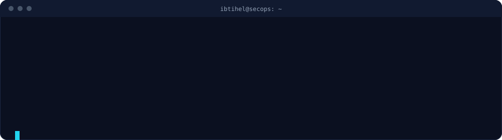

  

 

  

  

  

  

<picture>
  <source media="(prefers-color-scheme: dark)" srcset="https://raw.githubusercontent.com/ibtihelsalhi/ibtihelsalhi/output/github-snake-dark.svg">
  
</picture>

  

